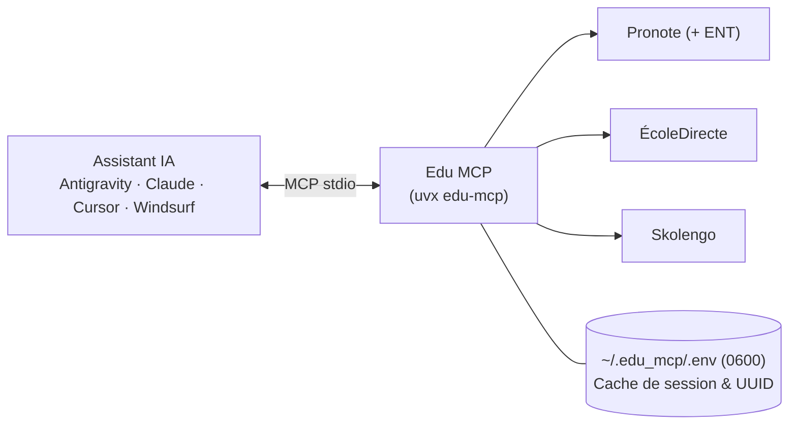

<div align="center">


<h1>Edu MCP</h1>

<p>
  <strong>Le serveur Model Context Protocol (MCP) unifié pour la vie scolaire française.</strong><br />
  Connectez <strong>Pronote (+ ENT)</strong>, <strong>ÉcoleDirecte</strong> et <strong>Skolengo</strong> à votre assistant IA en quelques secondes.
</p>

<p>
  <a href="README.md">English</a> · <a href="README.fr.md"><strong>Français</strong></a>
</p>

<p>
  <a href="https://github.com/jujukingg/pronote-mcp/actions/workflows/ci.yml"></a>
  <a href="https://pypi.org/project/edu-mcp/"></a>
  
  <a href="LICENSE"></a>
</p>

</div>

---

## Plateformes supportées

<table>
  <tr>
    <td align="center" width="33%">
      <br /><br />
      <strong>Pronote (+ ENT)</strong> &nbsp;<br />
      <sub>Toutatice, MonBureauNumérique, Île-de-France, Atrium…</sub><br /><br />
      <code>Navigateur SSO + 2FA + Jeton QR</code>
    </td>
    <td align="center" width="33%">
      <br /><br />
      <strong>ÉcoleDirecte</strong> &nbsp;<br />
      <sub>Espaces élève &amp; famille multi-enfants</sub><br /><br />
      <code>Identifiants + QCM 2FA</code>
    </td>
    <td align="center" width="33%">
      <br /><br />
      <strong>Skolengo</strong> &nbsp;<br />
      <sub>Recherche d'établissement &amp; ENT fédéré</sub><br /><br />
      <code>OAuth2 PKCE Navigateur</code>
    </td>
  </tr>
</table>

---

## Architecture



> [!IMPORTANT]
> **Confidentialité & sécurité**
> - **Zéro fuite dans le chat** : Pronote et Skolengo s'authentifient directement dans votre navigateur système — aucun mot de passe ne transite par la conversation.
> - **Messagerie en lecture seule** : L'IA peut lire vos messages et actualités, jamais en envoyer.
> - **Stockage 100 % local** : Vos jetons et caches restent sur votre machine dans `~/.edu_mcp/.env` (`chmod 600`).

---

## Démarrage rapide

### 1. Ajouter à votre client IA

Collez ce bloc dans votre fichier de configuration MCP (sans cloner le dépôt ni installer Python manuellement) :

```json
{
  "mcpServers": {
    "edu-mcp": {
      "command": "uvx",
      "args": ["edu-mcp"]
    }
  }
}
```

<details>
<summary><strong>Où se trouve mon fichier de configuration MCP ?</strong> (Antigravity, Claude Desktop, Cursor, Windsurf, VS Code)</summary>

| Client | Emplacement du fichier |
|---|---|
| **Antigravity** | `~/.gemini/config/mcp_config.json` |
| **Claude Desktop (macOS)** | `~/Library/Application Support/Claude/claude_desktop_config.json` |
| **Claude Desktop (Windows)** | `%APPDATA%\Claude\claude_desktop_config.json` |
| **Cursor** | `~/.cursor/mcp.json` ou `.cursor/mcp.json` |
| **Windsurf** | `~/.codeium/windsurf/mcp_config.json` |
| **VS Code (Copilot)** | `.vscode/mcp.json` |

</details>

<details>
<summary><strong>Alternative :</strong> Installation via <code>pip</code> ou depuis un clone local</summary>

```bash
pip install edu-mcp
edu-mcp
```

Ou depuis un dépôt cloné :

```json
{
  "mcpServers": {
    "edu-mcp": {
      "command": "python",
      "args": ["-m", "edu_mcp"],
      "cwd": "/chemin/vers/pronote_mcp"
    }
  }
}
```

</details>

### 2. Se connecter depuis le chat

Demandez simplement à votre assistant :

> *« Connecte mon compte Pronote / ÉcoleDirecte / Skolengo »*

1. L'assistant appelle `edu_setup_account` et vous guide selon votre plateforme.
2. **Pronote / Skolengo** : votre navigateur s'ouvre sur la page officielle ; connectez-vous normalement (ENT + 2FA) et le jeton durable est capturé automatiquement.
3. **ÉcoleDirecte** : connexion avec validation QCM 2FA ; les jetons d'appareil de confiance (`cn`/`cv`) sont enregistrés pour les sessions suivantes.

---

## Fonctionnalités

| Catégorie | Ce que votre assistant peut faire |
|---|---|
| **Emploi du temps** | Consulter les cours, salles, professeurs, annulations et contenus de séance ; exporter en `.ics` ou `.pdf`. |
| **Devoirs** | Lister le cahier de texte avec pièces jointes et cocher les devoirs effectués. |
| **Notes & Analyses** | Lire notes, moyennes élève/classe, compétences, bulletins, simuler une note et suivre la progression. |
| **Vie scolaire** | Consulter absences, retards, punitions, menus de cantine et actualités de l'établissement. |
| **Messagerie** | Lire les discussions et messages non lus *(lecture seule uniquement)*. |
| **Espace Parent** | Lister les enfants rattachés et basculer d'un enfant à l'autre. |

<details>
<summary><strong>Référence complète des outils, ressources et prompts</strong> (25+ outils)</summary>

### Outils unifiés multi-plateformes (`edu_*`)

| Outil | Description |
|---|---|
| `edu_list_platforms` | Liste les plateformes supportées et recherche les établissements Skolengo. |
| `edu_setup_account` | Configuration guidée pour Pronote, ÉcoleDirecte ou Skolengo. |
| `edu_get_user_info` | Profil actif (nom, classe, établissement, type de compte). |
| `edu_get_timetable` | Emploi du temps sur une plage de dates. |
| `edu_get_homework` / `edu_set_homework_done` | Liste des devoirs et marquage fait/à faire. |
| `edu_get_grades` / `edu_get_averages` | Notes individuelles et moyennes par matière. |
| `edu_get_absences` | Absences, retards et punitions. |
| `edu_get_news` | Actualités et communications de l'établissement. |
| `edu_get_discussions` / `edu_get_discussion_messages` | Fils de discussion et messages (lecture seule). |
| `edu_list_children` / `edu_select_child` | Sélection d'enfant pour les comptes parents. |

> Les outils avancés Pronote (`pronote_weekly_radar`, `pronote_simulate_grade`, `pronote_analyze_progression`, `pronote_get_evaluations`, `pronote_get_report`, `pronote_get_canteen_menu`, `pronote_export_ical`, `pronote_export_timetable_pdf`, `pronote_download_attachment`) sont également enregistrés.

### Ressources & Prompts

- **Ressources** : `pronote://student/profile`, `pronote://timetable/today`, `pronote://homework/pending`, `pronote://grades/overview`, `pronote://messages/unread`, `pronote://academics/weekly-radar`
- **Prompts** : `pronote_daily_briefing`, `pronote_homework_planner`, `pronote_period_review`

</details>

<details>
<summary><strong>Variables d'environnement</strong> (résolues via <code>PRONOTE_ENV_FILE</code>, <code>~/.edu_mcp/.env</code> ou <code>./.env</code>)</summary>

| Variable | Description |
|---|---|
| `EDU_PLATFORM` | Plateforme active : `pronote`, `ecoledirecte` ou `skolengo`. |
| `PRONOTE_MCP_HOME` | Dossier personnalisé pour `.env`, cache et logs (défaut : `~/.edu_mcp`). |
| `PRONOTE_ENV_FILE` | Chemin explicite vers un fichier `.env`. |
| `PRONOTE_URL` | URL complète de l'espace Pronote (`eleve.html` ou `parent.html`). |
| `PRONOTE_USERNAME` / `PRONOTE_TOKEN` | Identifiant et jeton durable (généré automatiquement). |
| `PRONOTE_ACCOUNT_PIN` | Code PIN 2FA à 4 chiffres (optionnel). |
| `EDU_ED_CN` / `EDU_ED_CV` | Jetons d'appareil de confiance 2FA ÉcoleDirecte. |
| `EDU_SKOLENGO_TOKEN` / `EDU_SKOLENGO_REFRESH_TOKEN` | Jetons OAuth2 Skolengo. |
| `PRONOTE_DOWNLOAD_DIR` | Dossier des pièces jointes et exports (défaut : `./downloads`). |

</details>

---

## Développement

```bash
git clone https://github.com/jujukingg/pronote-mcp.git
cd pronote-mcp
pip install -e ".[dev]"
pytest tests/unit -v
```

---

<p align="center">
  Distribué sous licence <a href="LICENSE">MIT</a>.
</p>
