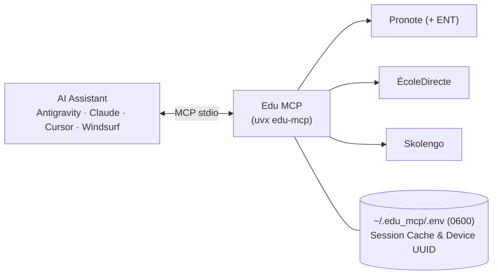

<div align="center">


<h1>Edu MCP</h1>

<p>
  <strong>The unified Model Context Protocol server for French school platforms.</strong><br />
  Connect <strong>Pronote (+ ENT)</strong>, <strong>ÉcoleDirecte</strong>, and <strong>Skolengo</strong> to your AI assistant in seconds.
</p>

<p>
  <a href="README.md"><strong>English</strong></a> · <a href="README.fr.md">Français</a>
</p>

<p>
  <a href="https://github.com/jujukingg/pronote-mcp/actions/workflows/ci.yml"></a>
  <a href="https://pypi.org/project/edu-mcp/"></a>
  
  <a href="LICENSE"></a>
</p>

</div>

---

## Supported Platforms

<table>
  <tr>
    <td align="center" width="33%">
      <br /><br />
      <strong>Pronote (+ ENT)</strong> &nbsp;<br />
      <sub>Toutatice, MonBureauNumérique, Île-de-France, Atrium…</sub><br /><br />
      <code>Browser SSO + 2FA + QR Token</code>
    </td>
    <td align="center" width="33%">
      <br /><br />
      <strong>ÉcoleDirecte</strong> &nbsp;<br />
      <sub>Student &amp; Family multi-child spaces</sub><br /><br />
      <code>Credentials + QCM 2FA</code>
    </td>
    <td align="center" width="33%">
      <br /><br />
      <strong>Skolengo</strong> &nbsp;<br />
      <sub>School search &amp; federated ENT login</sub><br /><br />
      <code>OAuth2 PKCE Browser</code>
    </td>
  </tr>
</table>

---

## How It Works



> [!IMPORTANT]
> **Privacy & Security by Design**
> - **Zero-leak login**: Pronote & Skolengo authenticate directly in your native browser — passwords never enter the chat.
> - **Read-only messaging**: Your AI can read school announcements and discussion threads, never send messages.
> - **Local-only storage**: Tokens and session caches stay on your machine in `~/.edu_mcp/.env` (`chmod 600`).

---

## Quick Start

### 1. Add to Your AI Client

Paste this into your MCP configuration file — no cloning or manual Python setup required:

```json
{
  "mcpServers": {
    "edu-mcp": {
      "command": "uvx",
      "args": ["edu-mcp"]
    }
  }
}
```

<details>
<summary><strong>Where is my MCP config file?</strong> (Antigravity, Claude Desktop, Cursor, Windsurf, VS Code)</summary>

| Client | Configuration Path |
|---|---|
| **Antigravity** | `~/.gemini/config/mcp_config.json` |
| **Claude Desktop (macOS)** | `~/Library/Application Support/Claude/claude_desktop_config.json` |
| **Claude Desktop (Windows)** | `%APPDATA%\Claude\claude_desktop_config.json` |
| **Cursor** | `~/.cursor/mcp.json` or `.cursor/mcp.json` |
| **Windsurf** | `~/.codeium/windsurf/mcp_config.json` |
| **VS Code (Copilot)** | `.vscode/mcp.json` |

</details>

<details>
<summary><strong>Alternative:</strong> Run via <code>pip</code> or from a local git clone</summary>

```bash
pip install edu-mcp
edu-mcp
```

Or from a cloned repository:

```json
{
  "mcpServers": {
    "edu-mcp": {
      "command": "python",
      "args": ["-m", "edu_mcp"],
      "cwd": "/path/to/pronote_mcp"
    }
  }
}
```

</details>

### 2. Connect in Chat

Just ask your assistant:

> *"Connect my Pronote / ÉcoleDirecte / Skolengo account"*

1. The assistant calls `edu_setup_account` and guides you through the exact flow for your platform.
2. **Pronote / Skolengo**: your browser opens on the official login page; sign in normally (ENT + 2FA) and your durable token is captured automatically.
3. **ÉcoleDirecte**: sign in once with QCM 2FA verification; trusted device tokens (`cn`/`cv`) are saved for future sessions.

---

## Capabilities

| Category | What Your Assistant Can Do |
|---|---|
| **Schedule** | Fetch daily/weekly timetables, room changes, cancellations, and lesson content; export `.ics` or `.pdf`. |
| **Homework** | List upcoming assignments with attachments and mark homework as done/pending. |
| **Grades & Analytics** | Read grades, subject & class averages, skill evaluations, report cards, simulate grades, and track progression. |
| **School Life** | Check absences, delays, punishments, canteen menus, and school news. |
| **Messaging** | Read unread threads and announcements *(strictly read-only)*. |
| **Parent Mode** | List linked children and switch active child seamlessly. |

<details>
<summary><strong>Full MCP Tool, Resource &amp; Prompt Reference</strong> (25+ tools)</summary>

### Unified Multi-Platform Tools (`edu_*`)

| Tool | Description |
|---|---|
| `edu_list_platforms` | List supported platforms and search Skolengo schools. |
| `edu_setup_account` | Chat-guided setup for Pronote, ÉcoleDirecte, or Skolengo. |
| `edu_get_user_info` | Active user profile (name, class, school, account type). |
| `edu_get_timetable` | Timetable lessons for a date range. |
| `edu_get_homework` / `edu_set_homework_done` | Homework list and completion toggle. |
| `edu_get_grades` / `edu_get_averages` | Individual grades and subject/class averages. |
| `edu_get_absences` | Absences, delays, and punishments. |
| `edu_get_news` | School announcements and news items. |
| `edu_get_discussions` / `edu_get_discussion_messages` | Read-only messaging threads and messages. |
| `edu_list_children` / `edu_select_child` | Multi-child switching for parent accounts. |

> **Pronote-specific & Analytics tools** (`pronote_weekly_radar`, `pronote_simulate_grade`, `pronote_analyze_progression`, `pronote_get_evaluations`, `pronote_get_report`, `pronote_get_canteen_menu`, `pronote_export_ical`, `pronote_export_timetable_pdf`, `pronote_download_attachment`) are also registered.

### Resources & Prompts

- **Resources**: `pronote://student/profile`, `pronote://timetable/today`, `pronote://homework/pending`, `pronote://grades/overview`, `pronote://messages/unread`, `pronote://academics/weekly-radar`
- **Prompts**: `pronote_daily_briefing`, `pronote_homework_planner`, `pronote_period_review`

</details>

<details>
<summary><strong>Environment Variables</strong> (resolved from <code>PRONOTE_ENV_FILE</code>, <code>~/.edu_mcp/.env</code>, or local <code>.env</code>)</summary>

| Variable | Description |
|---|---|
| `EDU_PLATFORM` | Active platform: `pronote`, `ecoledirecte`, or `skolengo`. |
| `PRONOTE_MCP_HOME` | Custom directory for `.env`, session cache, and logs (default: `~/.edu_mcp`). |
| `PRONOTE_ENV_FILE` | Explicit path to a `.env` file. |
| `PRONOTE_URL` | Full Pronote web space URL (`eleve.html` or `parent.html`). |
| `PRONOTE_USERNAME` / `PRONOTE_TOKEN` | Username and durable token (auto-generated). |
| `PRONOTE_ACCOUNT_PIN` | Optional 4-digit 2FA PIN. |
| `EDU_ED_CN` / `EDU_ED_CV` | ÉcoleDirecte trusted 2FA device tokens. |
| `EDU_SKOLENGO_TOKEN` / `EDU_SKOLENGO_REFRESH_TOKEN` | Skolengo OAuth2 tokens. |
| `PRONOTE_DOWNLOAD_DIR` | Directory for downloaded attachments and exports (default: `./downloads`). |

</details>

---

## Development

```bash
git clone https://github.com/jujukingg/pronote-mcp.git
cd pronote-mcp
pip install -e ".[dev]"
pytest tests/unit -v
```

---

<p align="center">
  Released under the <a href="LICENSE">MIT License</a>.
</p>
